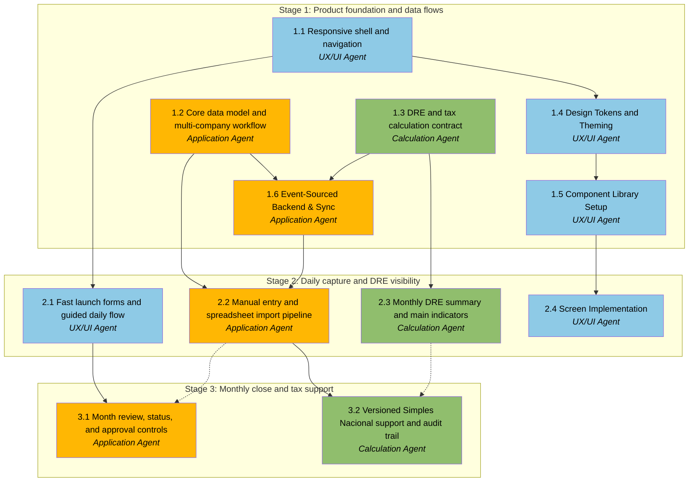

# APM Plan

## Workers

| Worker | Domain | Description |
|---|---|---|
| UX/UI Agent | Experience and presentation | Builds the responsive interface, daily workflow, dashboard, DRE views, and all user-facing simplicity patterns. |
| Application Agent | Data and workflow services | Builds persistence, multi-company data handling, launch intake, spreadsheet import, month status handling, backend sync engine, and shared application flows. |
| Calculation Agent | DRE and tax support | Builds DRE aggregation, cost group summaries, Simples Nacional support calculations, and versioned rule handling. |

## Stages

| Stage | Name | Tasks | Agents |
|---|---|---|---|
| Stage 1 | Product foundation and data flows | 6 | UX/UI Agent, Application Agent, Calculation Agent |
| Stage 2 | Daily capture and DRE visibility | 4 | UX/UI Agent, Application Agent, Calculation Agent |
| Stage 3 | Monthly close and tax support | 2 | Application Agent, Calculation Agent, UX/UI Agent |

## Updated Plan for Design Adaptation

### New Tasks for Design Integration

#### Task 1.4: Design Tokens and Theming - UX/UI Agent

* **Objective:** Implement the design tokens (colors, typography, spacing) and theming system based on the provided high-fidelity prototypes.
* **Output:** A reusable theming system supporting light and dark modes, aligned with the design tokens.
* **Validation:** Tokens are applied consistently across all components, and the theming system can toggle between light and dark modes without visual inconsistencies.
* **Guidance:** Use the tokens defined in the design files as the source of truth. Ensure accessibility standards are met for contrast and readability.
* **Dependencies:** Task 1.1 (Responsive shell and navigation).

1. Extract and define design tokens from the provided prototypes.
2. Implement a theming system that applies these tokens globally.
3. Validate the visual consistency and accessibility of the themes.

#### Task 1.5: Component Library Setup - UX/UI Agent

* **Objective:** Recreate the base UI components (e.g., buttons, inputs, cards) using the design system and tokens.
* **Output:** A library of reusable components that adhere to the design specifications.
* **Validation:** Components match the design prototypes pixel-perfectly and are responsive.
* **Guidance:** Focus on modularity and reusability. Ensure components are accessible and optimized for both desktop and mobile.
* **Dependencies:** Task 1.4 (Design Tokens and Theming).

1. Build the base components (buttons, inputs, etc.) using the design tokens.
2. Ensure components are responsive and accessible.
3. Validate the components against the design prototypes.

#### Task 2.4: Screen Implementation - UX/UI Agent

* **Objective:** Implement the main screens (dashboard, DRE view, month-close) based on the design prototypes.
* **Output:** Fully functional screens integrated with the existing application framework.
* **Validation:** Screens are visually consistent with the prototypes and functionally integrated with the backend.
* **Guidance:** Use the component library for consistency. Ensure screens are optimized for performance and usability.
* **Dependencies:** Task 1.5 (Component Library Setup).

1. Implement the dashboard screen with KPIs and quick actions.
2. Build the DRE view with interactive elements.
3. Create the month-close screen with status and approval controls.

---

### Updated Dependency Graph

---

> **Notes:**
> - The critical path runs through data model stability first, then fast entry flows, then DRE aggregation and monthly close controls.
> - UI and application work can move in parallel after the shared data contract is established, while tax support must wait for the monthly aggregation shape to be stable.
> - The strongest convergence point is the monthly close: status control, DRE display, and calculation traceability meet there and should be validated together at the end.
> - The import path is intentionally separate from the manual path so each can be validated without coupling all input behavior to one implementation.

## Stage 1: Product foundation and data flows

This stage establishes the minimum foundation needed for all later work: a responsive shell, a shared data model for multi-company cost tracking, and a calculation contract for DRE and Simples support. The tasks are separated because interface layout, storage/workflow shape, and calculation rules are different mental models and can be validated independently once the shared assumptions are in place.

### Task 1.1: Responsive shell and navigation - UX/UI Agent

* **Objective:** Build the responsive application shell, navigation, and global layout patterns that support simple daily use on mobile and desktop.
* **Output:** Responsive shell, top-level navigation, global dashboard frame, and layout primitives for the launch, DRE, and month-close screens.
* **Validation:** The shell renders correctly on narrow and wide viewport sizes, exposes the main areas in no more than three taps/clicks from the dashboard, and does not depend on authentication to browse the MVP screens.
* **Guidance:** Keep the interface intentionally minimal and aligned with the simplicity rules from the Spec. Favor compact information density, clear hierarchy, and a dashboard that can later show only three core indicators. Avoid introducing flows that assume user accounts in the first release. Use the same responsive structure for both phone and desktop widths.
* **Dependencies:** None.

1. Define the global layout and responsive navigation for the MVP screens.
2. Create the dashboard frame and the reusable screen containers for launch, DRE, and month review areas.
3. Verify the layout supports the three-step limit for critical actions by design.

### Task 1.2: Core data model and multi-company workflow - Application Agent

* **Objective:** Establish the application data shape for companies, cost records, month state, and the separation between personal and company costs.
* **Output:** Data model, persistence layer, and workflow primitives for multi-company selection, monthly records, and cost classification.
* **Validation:** The model can store at least two companies, distinguish personal from company costs, and preserve month state without relying on a login system. Data writes should be queryable by company, by month, and by cost type.
* **Guidance:** Keep the model minimal but explicit: one user context may operate multiple companies, and each launch must clearly belong to one company or the personal bucket. Preserve the monthly status lifecycle open/in review/closed as first-class state. Do not introduce banking integrations or other deferred external dependencies. Keep the data contract stable enough for import and calculation tasks to consume.
* **Dependencies:** None.

1. Define the company, launch, and month-status entities needed for the MVP.
2. Implement the persistence or storage layer that can query by company, month, and cost type.
3. Expose the data contract needed by the import and calculation tasks.

### Task 1.3: DRE and tax calculation contract - Calculation Agent

* **Objective:** Define the calculation contract for DRE grouping and Simples Nacional support using versioned fiscal rules.
* **Output:** Calculation rules schema, DRE grouping contract, and a versioned tax-support model that can be consumed by later screens and services.
* **Validation:** Given a stable input set, the calculation contract returns repeatable DRE group totals, a final operating result, and a version tag for the fiscal rule set. The output must preserve the accountant-validation warning concept and remain usable as support rather than legal authority.
* **Guidance:** Treat the DRE baseline as a simplified operational report anchored to the provided DRE document, but allow the presentation to remain lighter than a formal accounting statement. Version fiscal rules explicitly so later changes do not alter prior periods silently. Keep the contract able to handle the Simples Nacional context for 2026-oriented support and future revisions. Avoid hard-coding one-off assumptions that would make the support layer brittle.
* **Dependencies:** **Task 1.2 by Application Agent**.

1. Define the DRE group mapping and the versioned fiscal-rule input shape.
2. Implement repeatable aggregation logic for revenue, deductions, expenses, financial income, and operating result.
3. Expose a calculation payload that later UI and review screens can render directly.

### Task 1.4: Design Tokens and Theming - UX/UI Agent

* **Objective:** Implement the design tokens (colors, typography, spacing) and theming system based on the provided high-fidelity prototypes.
* **Output:** A reusable theming system supporting light and dark modes, aligned with the design tokens.
* **Validation:** Tokens are applied consistently across all components, and the theming system can toggle between light and dark modes without visual inconsistencies.
* **Guidance:** Use the tokens defined in the design files as the source of truth. Ensure accessibility standards are met for contrast and readability.
* **Dependencies:** Task 1.1 (Responsive shell and navigation).

1. Extract and define design tokens from the provided prototypes.
2. Implement a theming system that applies these tokens globally.
3. Validate the visual consistency and accessibility of the themes.

### Task 1.5: Component Library Setup - UX/UI Agent

* **Objective:** Recreate the base UI components (e.g., buttons, inputs, cards) using the design system and tokens.
* **Output:** A library of reusable components that adhere to the design specifications.
* **Validation:** Components match the design prototypes pixel-perfectly and are responsive.
* **Guidance:** Focus on modularity and reusability. Ensure components are accessible and optimized for both desktop and mobile.
* **Dependencies:** Task 1.4 (Design Tokens and Theming).

1. Build the base components (buttons, inputs, etc.) using the design tokens.
2. Ensure components are responsive and accessible.
3. Validate the components against the design prototypes.

### Task 1.6: Event-Sourced Backend and Sync Engine - Application Agent

* **Objective:** Build the Node.js backend (Fastify + PostgreSQL) with event-sourced persistence, offline-first sync protocol, and audit trail support.
* **Output:** RESTful sync APIs (push/pull), event store, conflict resolution, backup/export, and deployment-ready server.
* **Validation:** The backend can accept event batches from offline clients, resolve conflicts deterministically, persist events with audit metadata, and serve synced state back to clients. Sync operations work correctly under network latency and offline scenarios.
* **Guidance:** Implement the architecture defined in `.apm/data-architecture.md`. Use PostgreSQL for durability and JSONB for flexible event payloads. Keep the sync protocol stateless and repeatable so clients can resync without loss. Preserve the full event log for auditability even after projections are computed. Design for multi-user scale (future); for MVP, user context is optional but the schema should support it.
* **Dependencies:** **Task 1.2 by Application Agent, Task 1.3 by Calculation Agent**.

1. Set up Node.js project (Fastify, TypeORM/Prisma, PostgreSQL).
2. Implement the event store schema and append-only writes.
3. Build sync endpoints (POST /sync/push, GET /sync/pull).
4. Implement conflict resolution and merge logic.
5. Add backup/export and import endpoints.
6. Set up PostgreSQL migrations and connection pooling.

## Stage 2: Daily capture and DRE visibility

This stage delivers the daily usage loop: quick entry, batch import, and a usable DRE summary. The tasks are separated because the launch experience, import handling, and DRE presentation can be validated against the same data contract but should fail independently if one area regresses.

### Task 2.1: Fast launch forms and guided daily flow - UX/UI Agent

* **Objective:** Create the minimal launch experience and guided daily flow that let a user record costs in as few steps as possible.
* **Output:** Manual launch forms, daily next-step prompts, minimal required fields, and UI patterns for personal and company cost entry.
* **Validation:** A launch can be completed in three steps or fewer, required fields stay minimal, and the daily flow clearly guides the user toward the next relevant action. The layout must remain usable on phone and desktop.
* **Guidance:** Prioritize speed and clarity over dense data entry. Keep optional fields collapsed or deferred, and make the difference between personal and company launches obvious without forcing accounting jargon. Ensure the flow is compatible with the data model from Stage 1 and does not assume authentication. Keep the form structure aligned with future spreadsheet import so users see the same conceptual fields when possible.
* **Dependencies:** **Task 1.1 by UX/UI Agent, Task 1.2 by Application Agent**.

1. Design the launch flow and its required/optional field split.
2. Build the daily guided interaction pattern that surfaces the next relevant action.
3. Confirm the form path respects the three-step limit for critical actions.

### Task 2.2: Manual entry and spreadsheet import pipeline - Application Agent

* **Objective:** Implement cost ingestion through manual entry and spreadsheet import with validation and company/month routing.
* **Output:** Create/update flows for manual entries, CSV/Excel import processing, row validation feedback, and storage of imported results.
* **Validation:** The system can create a valid launch manually, import a file with multiple rows, reject malformed rows with useful feedback, and keep imported records separated by company and cost type. The import path must not break manual entry.
* **Guidance:** Treat manual entry as the primary path and import as a convenience path. Normalize incoming rows into the same internal model used by manual entries so downstream calculations do not care about source. Handle imperfect real-world spreadsheets gracefully and surface line-level validation errors. Keep the import pipeline independent enough that future banking integration can be added later without changing the base launch contract.
* **Dependencies:** **Task 1.2 by Application Agent**.

1. Implement the manual entry flow against the shared data model.
2. Build the spreadsheet import parser, mapping, and validation feedback.
3. Persist imported rows into the same normalized launch structure as manual entries.

### Task 2.3: Monthly DRE summary and main indicators - Calculation Agent

* **Objective:** Render the monthly DRE summary and the small set of main indicators from the calculation layer.
* **Output:** Monthly DRE summary output, compact indicator set, cost-group summaries, and result presentation data for the dashboard.
* **Validation:** The summary shows revenue, deductions, expenses, financial income, and operating result; the main indicators are visible without deep navigation; and the output stays consistent with the calculation contract from Stage 1. The presentation should remain simpler than the source DRE document while preserving the essential meaning.
* **Guidance:** Use the simplified DRE grouping agreed in the Spec and rely on the versioned calculation contract rather than recalculating in the UI. Keep the dashboard limited to the smallest useful set of indicators and avoid overloading it with accounting detail. Ensure the same summary can feed both the dashboard and the deeper DRE view. The output should clearly support daily monitoring, not only month-end review.
* **Dependencies:** **Task 1.3 by Calculation Agent**.

1. Transform calculation outputs into monthly summary data and the compact indicator set.
2. Align the DRE view with the simplified reporting structure.
3. Verify the same summary data can power both the dashboard and the report view.

### Task 2.4: Screen Implementation - UX/UI Agent

* **Objective:** Implement the main screens (dashboard, DRE view, month-close) based on the design prototypes.
* **Output:** Fully functional screens integrated with the existing application framework.
* **Validation:** Screens are visually consistent with the prototypes and functionally integrated with the backend.
* **Guidance:** Use the component library for consistency. Ensure screens are optimized for performance and usability.
* **Dependencies:** Task 1.5 (Component Library Setup).

1. Implement the dashboard screen with KPIs and quick actions.
2. Build the DRE view with interactive elements.
3. Create the month-close screen with status and approval controls.

## Stage 3: Monthly close and tax support

This stage adds the monthly control layer that protects the close, versions the Simples National support rules, and preserves the traceability needed to trust the numbers. The tasks are split because month-state control and fiscal-rule versioning are tightly related but still independently testable once the monthly DRE exists.

### Task 3.1: Month review, status, and approval controls - Application Agent

* **Objective:** Add the open/in review/closed lifecycle and the Dono approval control for the monthly DRE.
* **Output:** Month status transitions, approval controls, edit protection for closed periods, and visible month review state.
* **Validation:** A month can move through open, in review, and closed states; the Dono can approve the close; and closed months are protected from accidental changes. The state should be visible in the workflow and persisted across reloads.
* **Guidance:** Keep the review flow short and obvious. This control should support the monthly close without introducing unnecessary bureaucracy. Ensure the state model works for multi-company use and ties cleanly into the DRE summary from Stage 2. If a month is reopened, the audit trail must still show that the close happened previously.
* **Dependencies:** **Task 2.1 by UX/UI Agent, Task 2.2 by Application Agent, Task 2.3 by Calculation Agent**.

1. Implement the month state transitions and approval action.
2. Protect closed periods from edits while preserving traceability.
3. Expose review state in the UI flow so the Dono can complete the close.

### Task 3.2: Versioned Simples Nacional support and audit trail - Calculation Agent

* **Objective:** Finalize the tax-support layer with versioned Simples Nacional rules and traceable calculation outputs.
* **Output:** Versioned Simples Nacional support data, audit metadata for calculations, and output that can explain which rule set produced the result.
* **Validation:** The support layer can identify the rule version used for a calculation, preserve historical results, and provide enough metadata to explain how the monthly support figure was derived. The output must continue to warn that accountant validation is required.
* **Guidance:** Keep the tax-support logic explicitly versioned so rule changes do not mutate historical months. Preserve the distinction between support calculations and authoritative accounting/tax filing. Make the outputs traceable enough to answer why a period changed after edits or imports. Align the tax support display with the monthly close so the user sees one coherent result, not separate conflicting numbers.
* **Dependencies:** **Task 2.2 by Application Agent, Task 2.3 by Calculation Agent, Task 3.1 by Application Agent**.

1. Finalize the versioned rule set structure for Simples Nacional support.
2. Attach calculation metadata so each month can show which rules were used.
3. Ensure historical months retain their prior support result even when rules are updated later.

