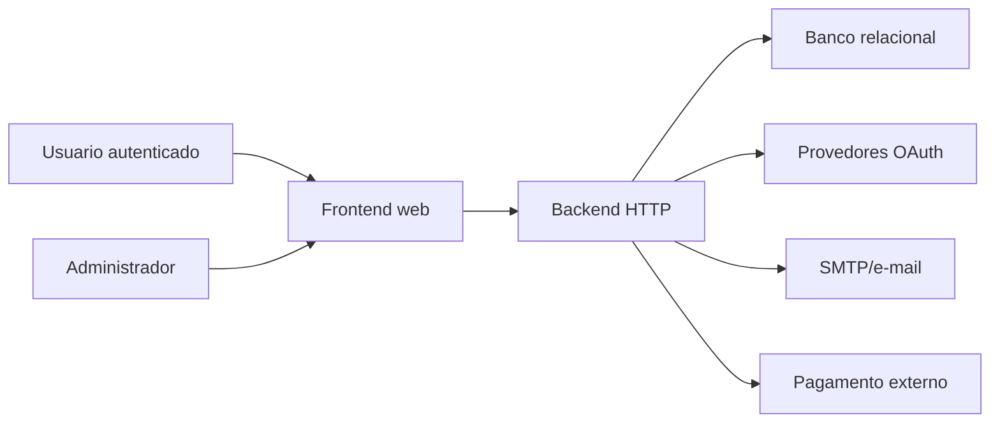

# Visao geral

EmpresaFacil e um sistema web para operacao financeira de pequenos negocios, com camada de apresentacao em `src/` e backend em `server/src/`. O manifesto raiz identifica o pacote como `empresa-facil` (`package.json:2`) e o backend como `empresa-facil-sync-server` (`server/package.json:2`). A documentacao tecnica serve para manutencao do codigo, evolucao da API, operacao de ambientes e onboarding de pessoas tecnicas.

## Objetivo do sistema

O sistema centraliza lancamentos, empresas, DRE, revisao mensal, importacao de extratos OFX e CSV, categorias, membros, onboarding, administracao e billing em uma aplicacao web autenticada. Essa superficie aparece nas rotas de frontend em `src/router.tsx:21-36` e nas rotas protegidas/admin em `src/App.tsx:18-64`; no backend, os modulos sao registrados em `server/src/app.js:57-64`.

## Escopo

Dentro do escopo:

- Interface web autenticada com dashboard, lancamentos, importacao OFX/CSV com perfis bancarios e memoria de categorizacao por empresa, conciliacao assistida de transferencias, fila de revisao de importados, DRE, registros, empresas, perfil tributario, membros, categorias, plano de contas, insights, previsao de caixa, revisao de deducoes, fechamento mensal e treinamento (`src/router.tsx`; `src/screens/ImportOFX.tsx`; `src/screens/ImportReview.tsx`).
- Area administrativa para estatisticas, empresas e usuarios (`src/App.tsx:24-53`; `server/src/routes/admin.js:8-165`).
- Backend HTTP com healthcheck, autenticacao, onboarding, membros, sincronizacao, backup, admin e billing (`server/src/app.js:57-64`).
- Persistencia relacional por migrations SQL (`server/migrations/001_init.sql:1`, `server/migrations/002_auth.sql:1`, `server/migrations/003_saas_base.sql:9`).

Fora do escopo identificado no codigo:

- Filas assincronas: `// CARENCIA: nao identificado no codigo`.
- Jobs agendados: `// CARENCIA: nao identificado no codigo`.
- Politica formal de versionamento de API: `// CARENCIA: nao identificado no codigo`.

## Atores

| Ator | Tipo | Papel no dominio | Interface | Evidencia |
|---|---|---|---|---|
| Usuario autenticado | Humano | Usa as telas operacionais protegidas | Frontend | `src/App.tsx:56-64` |
| Administrador | Humano | Acessa estatisticas, empresas e usuarios | Frontend/API | `src/App.tsx:24-53`; `server/src/routes/admin.js:8-165` |
| Owner da empresa | Humano | Gerencia membros, assinatura e portal de billing | API | `server/src/routes/members.js:47-132`; `server/src/routes/billing.js:24-85` |
| Provedor OAuth | Sistema | Fornece dados de identidade federada | API externa | `server/src/routes/auth.js:9-47` |
| Provedor de pagamento | Sistema | Cria checkout, portal e processa webhooks | API externa | `server/src/routes/billing.js:1-201` |
| Banco de dados | Sistema | Persiste eventos, usuarios, membros, tokens e assinaturas | PostgreSQL | `server/migrations/001_init.sql:1`; `server/migrations/002_auth.sql:1`; `server/migrations/003_saas_base.sql:9` |

## Proposta de valor tecnica

O repositorio combina uma aplicacao de uso diario com um backend de sincronizacao e auditoria. O frontend mantem rotas funcionais em `src/router.tsx:21-36`; o backend registra modulos de transporte em `server/src/app.js:57-64`; a base relacional preserva eventos em `audit_events` (`server/migrations/001_init.sql:1`) e dados SaaS em `subscriptions` (`server/migrations/003_saas_base.sql:9`).

## Visao de alto nivel

## Como navegar a documentacao

1. Leia `./02-arquitetura.md` para entender camadas e fronteiras.
2. Leia `./03-stack-e-dependencias.md` para inventario de runtime, frameworks e bibliotecas.
3. Leia `./07-interface-externa.md` para cobertura de endpoints.
4. Leia `./08-frontend.md` e `./09-backend.md` para manutencao por camada.
5. Leia os condicionais `./banco-de-dados.md`, `./auth.md`, `./integracoes-externas.md`, `./notificacoes.md` e `./multi-tenancy.md` para capacidades ativas.
