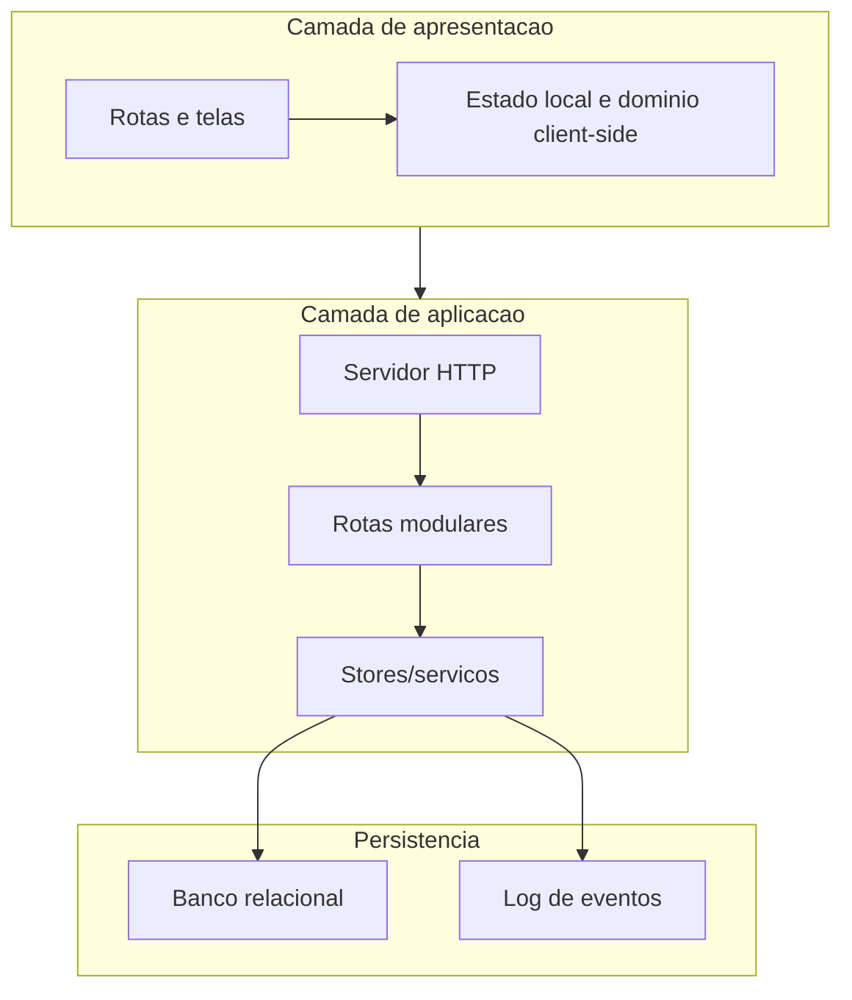

# Arquitetura

O sistema segue uma arquitetura full-stack com camada de apresentacao, camada de aplicacao HTTP, dominio local do frontend e infraestrutura de persistencia/sincronizacao. A separacao fisica aparece na raiz `src/`, no backend `server/src/`, nas migrations `server/migrations/` e nos manifestos de deploy `Dockerfile`, `server/Dockerfile`, `docker-compose.yml`, `cloudbuild.yaml` e `render.yaml`.

## Visao em camadas

| Camada | Responsabilidade | Fronteira | Evidencia |
|---|---|---|---|
| Apresentacao | Renderiza rotas, shell, telas e controles de usuario | Nao acessa diretamente o banco relacional | `src/App.tsx:17-64`; `src/router.tsx:21-36` |
| Dominio frontend | Mantem regras locais de empresas, lancamentos, calculos e ciclo mensal | Nao expoe endpoints HTTP | `src/domain.js:44-96`; `src/calculations.js:116-551`; `src/monthLifecycle.js:29-207` |
| Aplicacao backend | Registra middlewares, rotas e servicos HTTP | Nao renderiza telas | `server/src/app.js:15-64` |
| Persistencia | Define schema relacional, eventos, usuarios, membros e assinaturas | Nao implementa UI | `server/migrations/001_init.sql:1-41`; `server/migrations/002_auth.sql:1-45`; `server/migrations/003_saas_base.sql:2-25` |
| Infraestrutura | Empacota e publica frontend/backend | Nao contem regra de dominio | `Dockerfile:1-14`; `server/Dockerfile:1-6`; `cloudbuild.yaml:2-64`; `render.yaml:1-53` |

## Fluxo principal de uma requisicao

1. A tela protegida fica dentro de `RequireAuth` e `Shell`, carregando o roteador funcional (`src/App.tsx:56-64`).
2. A camada de apresentacao consome a URL base configurada em `VITE_API_URL` (`src/config.ts:1`).
3. O backend registra CORS, JWT e rate limit antes das rotas (`server/src/app.js:27-29`).
4. As rotas sao registradas por modulo (`server/src/app.js:57-64`).
5. Rotas protegidas usam `requireAuth` ou `requireAdmin` nos arquivos de rota (`server/src/routes/sync.js:62-79`; `server/src/routes/admin.js:8-165`).
6. Em erro nao tratado, o handler central registra erro e responde codigo HTTP derivado do erro (`server/src/app.js:66-76`).

## Decisoes de design

| Decisao | Motivo | Consequencia aceita | Evidencia |
|---|---|---|---|
| Frontend e backend no mesmo repositorio | Permitir evolucao coordenada da UI e da API | Build e deploy precisam tratar dois pacotes Node | `package.json:6-12`; `server/package.json:6-10` |
| Rotas privadas por wrapper no frontend | Centralizar protecao de telas operacionais | Login passa a ser pre-condicao para a area principal | `src/App.tsx:56-64` |
| Admin separado por wrapper proprio | Restringir area administrativa por privilegio | Permissao admin depende de checagem dedicada | `src/App.tsx:24-53`; `server/src/authMiddleware.js:16` |
| Backend modular por arquivos de rota | Separar auth, onboarding, membros, sync, backup, admin e billing | Contrato HTTP fica distribuido por modulo | `server/src/app.js:57-64` |
| Persistencia por migrations SQL | Manter schema versionado no repositorio | Mudancas de banco exigem nova migration | `server/src/migrate.js`; `server/migrations/001_init.sql:1` |

## Limites da arquitetura

- Nao ha evidencia de monorepo formal por workspace manager; frontend e backend vivem no mesmo repositorio, mas com `package.json` separados (`package.json:1-31`; `server/package.json:1-26`).
- A politica de versionamento de API nao aparece em rotas ou configuracao: `// CARENCIA: nao identificado no codigo`.
- Fila, cache e jobs agendados nao foram detectados nos manifestos ou no codigo: `// CARENCIA: nao identificado no codigo`.
