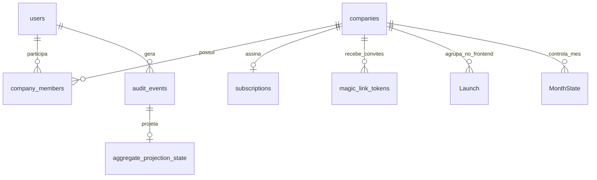

# Modelo de dominio

## Inventario de entidades

| Entidade | Responsabilidade no dominio | Evidencia |
|---|---|---|
| Company | Representa empresa ativa/gerenciada no frontend | `src/companyStore.ts:86-498`; `server/migrations/002_auth.sql:13` |
| Launch | Representa lancamento financeiro com `companyId` | `src/domain.js:44-62` |
| UserContext | Restringe operacoes a empresas autorizadas | `src/domain.js:86-96` |
| MonthState | Controla status mensal por empresa e mes | `src/monthLifecycle.js:29-207` |
| SimplesRuleCatalog | Agrupa regras versionadas de suporte fiscal | `src/calculations.js:116-139` |
| ImportProfile | Configuracao por empresa para leitura de OFX ou CSV | `src/importProfileStore.ts` |
| TransactionMemory | Regra confirmada de descricao para categoria, isolada por empresa | `src/transactionMemoryStore.ts` |
| audit_events | Log de eventos sincronizados/auditaveis | `server/migrations/001_init.sql:1` |
| aggregate_projection_state | Estado vencedor de projecoes por agregado | `server/migrations/001_init.sql:22` |
| backup_exports | Historico de exportacoes de backup | `server/migrations/001_init.sql:41` |
| users | Identidade persistida do usuario | `server/migrations/002_auth.sql:1` |
| companies | Empresas do backend SaaS | `server/migrations/002_auth.sql:13` |
| company_members | Relacao usuario-empresa-papel | `server/migrations/002_auth.sql:24` |
| magic_link_tokens | Tokens de login/convite por e-mail | `server/migrations/002_auth.sql:36` |
| subscriptions | Assinatura/plano por empresa | `server/migrations/003_saas_base.sql:9` |

## Relacionamentos e cardinalidades

## Invariantes de negocio

| Invariante | Entidade afetada | Ponto de imposicao | Evidencia |
|---|---|---|---|
| Lancamento precisa ter `companyId` nao vazio | Launch | Dominio frontend | `src/domain.js:44-62` |
| Contexto de usuario precisa ter ao menos uma empresa | UserContext | Dominio frontend | `src/domain.js:86-96` |
| Operacao em empresa inexistente falha | Company/Repository | Repositorio frontend | `src/repository.js:50-65` |
| Mes e empresa identificam estado mensal | MonthState | Store de ciclo mensal | `src/monthLifecycle.js:29-31` |
| E-mail de usuario e unico | users | Restricao SQL | `server/migrations/002_auth.sql:1-7` |
| Assinatura e unica por empresa | subscriptions | Restricao SQL | `server/migrations/003_saas_base.sql:9-11` |
| Admin nao deve depender apenas do JWT | users | Middleware admin | `server/src/authMiddleware.js:16` |

## Vocabulario ubiquo

| Termo | Definicao neste sistema | Codificacao | Evidencia |
|---|---|---|---|
| Empresa ativa | Empresa selecionada para operar telas e dados | `ACTIVE_COMPANY_STORAGE_KEY` | `src/companyStore.ts:86-498` |
| Lancamento | Registro financeiro associado a empresa | `launch.companyId` | `src/domain.js:44-62` |
| DRE | Visao de resultado mensal | Rota `/dre` | `src/router.tsx:25` |
| Fechamento mensal | Revisao e status do mes | Rota `/month-review` | `src/router.tsx:35` |
| Importacao de extrato | Entrada OFX ou CSV por perfil bancario, com previa e deduplicacao mensal | Rota `/import-ofx` | `src/router.tsx:24`; `src/lib/parseImportFile.ts` |
| Memoria de transacao | Categoria confirmada reutilizada para a mesma descricao, empresa, escopo e tipo | `TransactionMemory` | `src/transactionMemoryStore.ts` |
| Suporte Simples | Calculo versionado de apoio fiscal | `VERSIONED_SIMPLES_SUPPORT_CONTRACT` | `src/calculations.js:376-551` |
| Membro | Usuario vinculado a empresa por papel | `company_members` | `server/migrations/002_auth.sql:24` |
| Owner | Papel com capacidade de convite/remocao/portal | Rotas members/billing | `server/src/routes/members.js:47-132`; `server/src/routes/billing.js:73-85` |
| Audit event | Evento persistido para sincronizacao/auditoria | `audit_events` | `server/migrations/001_init.sql:1` |
| Magic link | Token de autenticacao/convite por e-mail | `magic_link_tokens` | `server/migrations/002_auth.sql:36` |

## Agregados e raizes

`// CARENCIA: nao identificado no codigo`. O codigo usa stores, entidades relacionais e funcoes de dominio, mas nao declara explicitamente padrao de agregados ou raizes de agregado.
