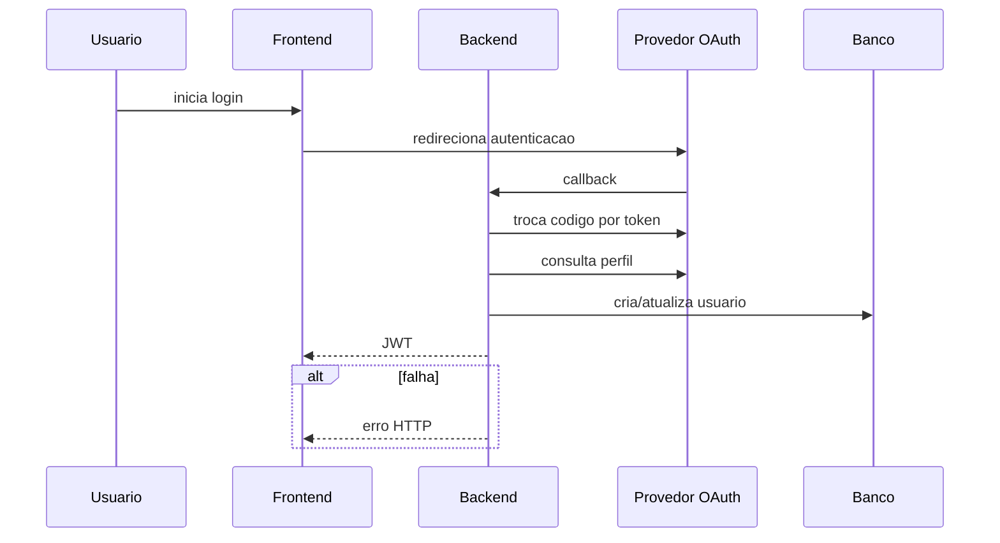
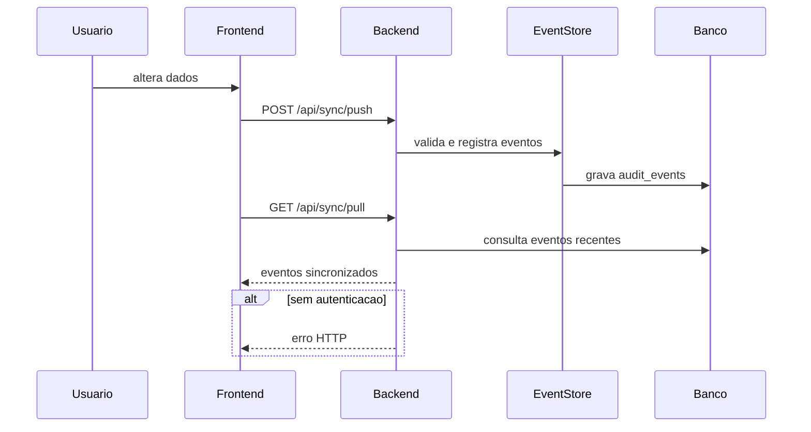
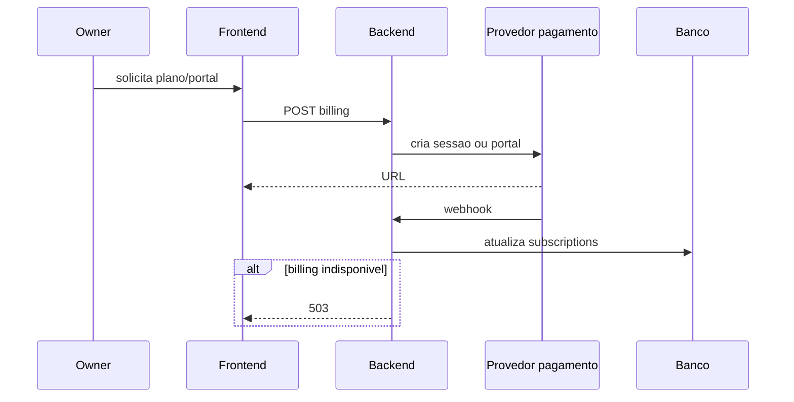

# Fluxos de negocio

## Inventario de fluxos

| Fluxo | Ator iniciador | Ponto de entrada | Evidencia |
|---|---|---|---|
| Login federado | Usuario | Callback OAuth | `server/src/routes/auth.js:9-47` |
| Solicitar e verificar magic link | Usuario | `/auth/magic-link/request` e `/auth/magic-link/verify` | `server/src/routes/auth.js:64-81` |
| Consultar sessao atual | Frontend | `/auth/me` | `server/src/routes/auth.js:116` |
| Sincronizar eventos | Frontend | `/api/sync/push` e `/api/sync/pull` | `server/src/routes/sync.js:62-79` |
| Gerenciar membros | Owner/membro | Rotas `/api/companies/:companyId/members` | `server/src/routes/members.js:10-127` |
| Onboarding/claim de empresa | Usuario | `/api/onboarding/status` e `/api/companies/claim` | `server/src/routes/onboarding.js:7-13` |
| Billing | Owner | `/billing/checkout`, `/billing/portal`, webhook | `server/src/routes/billing.js:24-201` |
| Operacao financeira no frontend | Usuario | Rotas internas | `src/router.tsx:21-36` |

## Fluxo: login federado

### Descricao

O backend recebe callback OAuth, troca codigo por token, consulta perfil externo, cria ou atualiza usuario e emite JWT de aplicacao. O fluxo Google aparece em `server/src/routes/auth.js:9-25`; o fluxo Microsoft aparece em `server/src/routes/auth.js:37-47`.

### Pre-condicoes

- OAuth Google ou Microsoft precisa estar registrado no app quando houver client id configurado (`server/src/app.js:31-53`).
- O backend precisa ter `JWT_SECRET` carregado para assinar token (`server/src/config.js:16`).

### Passos do caminho feliz

1. Usuario retorna ao callback OAuth (`server/src/routes/auth.js:9`; `server/src/routes/auth.js:37`).
2. Backend troca codigo por token no provedor (`server/src/routes/auth.js:11`; `server/src/routes/auth.js:39`).
3. Backend consulta perfil externo com bearer token (`server/src/routes/auth.js:12-13`; `server/src/routes/auth.js:41`).
4. Backend monta identidade com e-mail e provedor (`server/src/routes/auth.js:20-25`; `server/src/routes/auth.js:46`).
5. Backend assina JWT da aplicacao (`server/src/routes/auth.js:25`).

### Caminho de erro principal

1. Provedor OAuth nao esta configurado: rota especifica nao e registrada (`server/src/app.js:31-53`).
2. Falha de callback gera erro tratado pelo handler central (`server/src/app.js:66-76`).

### Pos-condicoes

- Caminho feliz: usuario possui JWT para chamadas protegidas (`server/src/routes/auth.js:25`).
- Caminho de erro: erro HTTP e retornado pelo handler central (`server/src/app.js:66-76`).

## Fluxo: sincronizar eventos

### Descricao

O frontend envia eventos locais para o backend e consulta eventos mais recentes por dispositivo/tempo. As rotas ficam em `server/src/routes/sync.js:62-79`.

### Pre-condicoes

- Usuario precisa estar autenticado porque as rotas usam `requireAuth` (`server/src/routes/sync.js:62-79`).
- Banco precisa estar configurado por `DATABASE_URL` (`server/src/config.js:14`; `server/src/db.js:5`).

### Passos do caminho feliz

1. Frontend envia `POST /api/sync/push` com JWT (`server/src/routes/sync.js:62`).
2. Backend associa eventos ao usuario autenticado (`server/src/eventStore.js:153`).
3. Eventos sao persistidos no log `audit_events` (`server/migrations/001_init.sql:1`).
4. Frontend consulta `GET /api/sync/pull` (`server/src/routes/sync.js:79`).
5. Backend limita volume pelo `SYNC_PULL_LIMIT` configurado (`server/src/config.js:15`).

### Caminho de erro principal

1. JWT ausente/invalido bloqueia `preHandler` (`server/src/routes/sync.js:62-79`).
2. Banco sem `DATABASE_URL` falha na inicializacao (`server/src/db.js:5`).

### Pos-condicoes

- Eventos aceitos permanecem auditaveis em `audit_events` (`server/migrations/001_init.sql:1`).
- Eventos supersedidos permanecem no log, enquanto estado vencedor e controlado por `aggregate_projection_state` (`server/migrations/001_init.sql:22`).

## Fluxo: billing

### Descricao

Usuarios autenticados acessam checkout e portal; webhooks atualizam assinatura conforme eventos do provedor de pagamento. As rotas principais estao em `server/src/routes/billing.js:24-201`.

### Pre-condicoes

- Rotas de checkout e portal exigem `requireAuth` (`server/src/routes/billing.js:24-73`).
- Chaves Stripe precisam estar configuradas; caso contrario a rota responde `billing_unavailable` (`server/src/routes/billing.js:26-75`).

### Passos do caminho feliz

1. Usuario chama `/billing/checkout` autenticado (`server/src/routes/billing.js:24`).
2. Backend valida configuracao de billing (`server/src/routes/billing.js:26`).
3. Backend cria sessao com SDK Stripe (`server/src/routes/billing.js:1`).
4. Owner chama `/billing/portal` para portal de cliente (`server/src/routes/billing.js:73-85`).
5. Webhook recebe evento e atualiza assinatura (`server/src/routes/billing.js:105-201`).

### Caminho de erro principal

1. Billing sem configuracao retorna `503 billing_unavailable` (`server/src/routes/billing.js:26`; `server/src/routes/billing.js:75`).
2. Usuario nao-owner recebe `403 apenas_owner_pode_acessar_portal` (`server/src/routes/billing.js:85`).

### Pos-condicoes

- Assinatura por empresa e persistida em `subscriptions` (`server/migrations/003_saas_base.sql:9-25`).
- Customer externo e associado a empresa pelo store de assinatura (`server/src/subscriptionStore.js:75-77`).

## Metricas de saude do fluxo

| Metrica | O que mede | Ponto de emissao | Evidencia |
|---|---|---|---|
| Logs estruturados de erro | Erros nao tratados no backend | Error handler | `server/src/app.js:66-76` |
| Healthcheck | Disponibilidade basica do backend | `/health` | `server/src/routes/health.js:2` |
| Readiness | Prontidao do backend/banco | `/ready` | `server/src/routes/health.js:11` |
