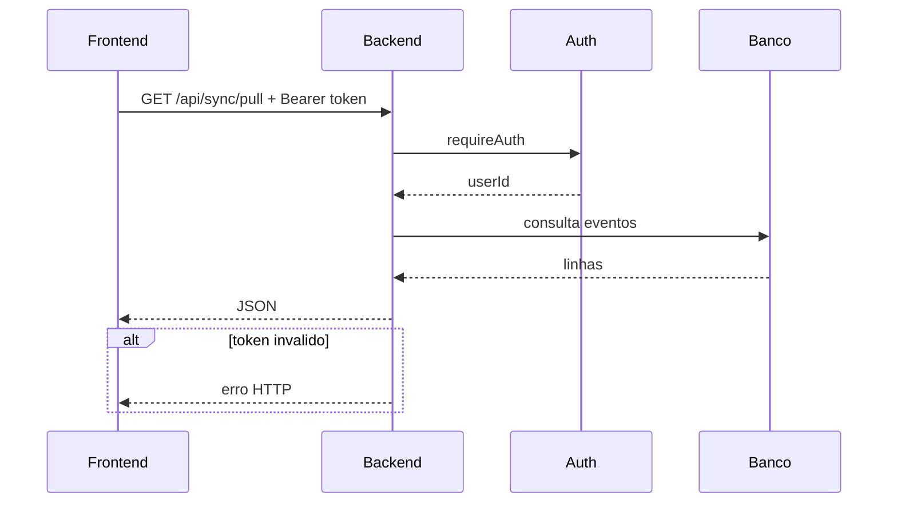

# Interface externa

## Inventario de endpoints sincronos

| Metodo | Caminho | Autenticacao | Requisicao | Resposta | Erros documentados | Evidencia |
|---|---|---|---|---|---|---|
| GET | `/health` | Nao | Sem corpo | JSON | `// CARENCIA` | `server/src/routes/health.js:2` |
| GET | `/ready` | Nao | Sem corpo | JSON | Erro de prontidao | `server/src/routes/health.js:11` |
| GET | `/auth/google/callback` | OAuth callback | Query do provedor | Redirecionamento/JWT | Handler central | `server/src/routes/auth.js:9` |
| GET | `/auth/microsoft/callback` | OAuth callback | Query do provedor | Redirecionamento/JWT | Handler central | `server/src/routes/auth.js:37` |
| POST | `/auth/magic-link/request` | Nao | JSON com e-mail/proposito | JSON | `email_invalido` | `server/src/routes/auth.js:64-69` |
| GET | `/auth/magic-link/verify` | Token magic link | Query token | JWT/redirecionamento | Handler central | `server/src/routes/auth.js:81` |
| GET | `/auth/me` | JWT | Header Authorization | Usuario atual | Nao autorizado | `server/src/routes/auth.js:116` |
| GET | `/api/backup/export` | Nao identificado | Sem corpo | Exportacao JSON | `// CARENCIA` | `server/src/routes/backup.js:2` |
| GET | `/api/onboarding/status` | JWT | Header Authorization | Status | Nao autorizado | `server/src/routes/onboarding.js:7` |
| POST | `/api/companies/claim` | JWT | JSON | Empresa reivindicada | Validacao | `server/src/routes/onboarding.js:13` |
| GET | `/api/companies/:companyId/members` | JWT | Path param | Lista de membros | Nao autorizado | `server/src/routes/members.js:10` |
| GET | `/api/companies/:companyId/subscription` | JWT | Path param | Assinatura | Nao autorizado | `server/src/routes/members.js:23` |
| POST | `/api/companies/:companyId/members/invite` | JWT | JSON e-mail/papel | Convite | `email_invalido`, `papel_invalido` | `server/src/routes/members.js:47-56` |
| DELETE | `/api/companies/:companyId/members/:targetUserId` | JWT | Path params | Remocao | Nao autorizado | `server/src/routes/members.js:105` |
| PATCH | `/api/companies/:companyId/members/:targetUserId` | JWT | JSON papel | Atualizacao | `papel_invalido` | `server/src/routes/members.js:127-132` |
| POST | `/api/sync/push` | JWT | JSON eventos | Resultado sync | Nao autorizado/validacao | `server/src/routes/sync.js:62` |
| GET | `/api/sync/pull` | JWT | Query `since`, `deviceId`, `limit` | Eventos | Nao autorizado | `server/src/routes/sync.js:79` |
| GET | `/admin/stats` | Admin | Header Authorization | Estatisticas | Nao autorizado | `server/src/routes/admin.js:8` |
| GET | `/admin/companies` | Admin | Query opcional | Empresas | Nao autorizado | `server/src/routes/admin.js:51` |
| GET | `/admin/companies/:companyId` | Admin | Path param | Empresa | Nao encontrado | `server/src/routes/admin.js:101` |
| PATCH | `/admin/companies/:companyId/plan` | Admin | JSON plano | Empresa atualizada | Validacao | `server/src/routes/admin.js:144` |
| GET | `/admin/users` | Admin | Query opcional | Usuarios | Nao autorizado | `server/src/routes/admin.js:165` |
| POST | `/billing/checkout` | JWT | JSON empresa/plano | URL checkout | `billing_unavailable` | `server/src/routes/billing.js:24-26` |
| POST | `/billing/portal` | JWT | JSON empresa | URL portal | `billing_unavailable`, `apenas_owner_pode_acessar_portal` | `server/src/routes/billing.js:73-85` |
| POST | Webhook de billing | Assinatura webhook | Payload provedor | ACK | Validacao de webhook | `server/src/routes/billing.js:105-201` |

## Inventario de mensagens consumidas e publicadas

Nao aplicavel. Nao foram identificadas filas, topicos ou canais assincronos no codigo: `// CARENCIA: nao identificado no codigo`.

## Mapa de chamadores externos

| Consumidor | Endpoints utilizados | Modo de autenticacao | Evidencia |
|---|---|---|---|
| Frontend web | Rotas `/auth/*`, `/api/*`, `/billing/*`, `/admin/*` | JWT em `Authorization` | `src/config.ts:1`; `src/components/RequireAdmin.tsx:19-20` |
| Provedor OAuth Google | `/auth/google/callback` | Callback OAuth | `server/src/routes/auth.js:9-13` |
| Provedor OAuth Microsoft | `/auth/microsoft/callback` | Callback OAuth | `server/src/routes/auth.js:37-41` |
| Provedor de pagamento | Webhook billing | Assinatura de webhook | `server/src/routes/billing.js:105-201` |

## Visao de fluxo entre chamador e sistema

## Versionamento da interface

`// CARENCIA: nao identificado no codigo`. As rotas usam prefixos funcionais (`/api`, `/auth`, `/admin`, `/billing`), mas nao ha versao explicita no caminho, cabecalho ou schema.

## Politica de erros

| Codigo | Significado | Estrutura do corpo | Evidencia |
|---|---|---|---|
| 400 | Erro de validacao | `{ error, ... }` | `server/src/routes/auth.js:69`; `server/src/routes/members.js:55-56` |
| 403 | Sem permissao de owner | `{ error: 'apenas_owner_pode_acessar_portal' }` | `server/src/routes/billing.js:85` |
| 503 | Billing nao configurado | `{ error: 'billing_unavailable', message }` | `server/src/routes/billing.js:26`; `server/src/routes/billing.js:75` |
| 500 | Erro nao tratado | `{ error: error.message }` | `server/src/app.js:66-76` |
