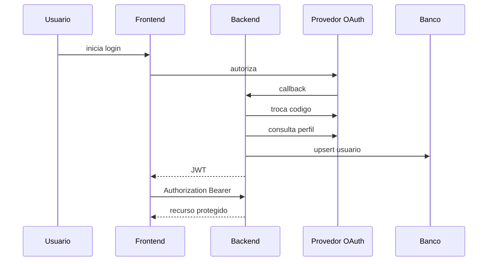

# Autenticacao e autorizacao

## Modelo de identidade

| Atributo | Tipo | Origem | Evidencia |
|---|---|---|---|
| `id` | Texto/identificador | Banco | `server/migrations/002_auth.sql:1` |
| `email` | Texto unico | OAuth ou magic link | `server/migrations/002_auth.sql:3`; `server/src/routes/auth.js:20-25` |
| `google_id` | Texto unico | Google OAuth | `server/migrations/002_auth.sql:6`; `server/src/routes/auth.js:9-25` |
| `microsoft_id` | Texto unico | Microsoft OAuth | `server/migrations/002_auth.sql:7`; `server/src/routes/auth.js:37-47` |
| `is_admin` | Booleano | Banco | `server/migrations/003_saas_base.sql:2`; `server/src/authMiddleware.js:16` |

## Fluxos de autenticacao suportados

| Fluxo | Iniciador | Provedor | Credencial emitida | Evidencia |
|---|---|---|---|---|
| Google OAuth callback | Usuario | Google | JWT da aplicacao | `server/src/app.js:31-40`; `server/src/routes/auth.js:9-25` |
| Microsoft OAuth callback | Usuario | Microsoft | JWT da aplicacao | `server/src/app.js:44-53`; `server/src/routes/auth.js:37-47` |
| Magic link request/verify | Usuario | E-mail/SMTP | JWT da aplicacao | `server/src/routes/auth.js:64-81`; `server/src/emailService.js:1-90` |
| Bearer token API | Frontend | JWT local | Usuario autenticado | `src/authStore.ts:3-16`; `src/components/RequireAdmin.tsx:19-20`; `server/src/routes/auth.js:116` |

## Fluxo de autenticacao principal

1. Provedor OAuth e registrado se houver client id configurado (`server/src/app.js:31-53`).
2. Usuario retorna ao callback do provedor (`server/src/routes/auth.js:9`; `server/src/routes/auth.js:37`).
3. Backend troca autorizacao por access token (`server/src/routes/auth.js:11`; `server/src/routes/auth.js:39`).
4. Backend consulta perfil externo com bearer token (`server/src/routes/auth.js:12-13`; `server/src/routes/auth.js:41`).
5. Backend cria/atualiza usuario com provedor e e-mail (`server/src/routes/auth.js:20-25`; `server/src/routes/auth.js:46`).
6. Backend assina JWT com expiracao de 30 dias no fluxo Google (`server/src/routes/auth.js:25`).
7. Frontend armazena token em `localStorage` (`src/authStore.ts:3-16`).
8. Chamadas protegidas usam header `Authorization: Bearer` (`src/components/RequireAdmin.tsx:19-20`).

## Politica de autorizacao

| Papel ou atributo | Capacidades concedidas | Ponto de imposicao | Evidencia |
|---|---|---|---|
| Usuario autenticado | Acessar rotas internas e API protegida | `RequireAuth` e `requireAuth` | `src/App.tsx:56-64`; `server/src/routes/sync.js:62-79` |
| Admin | Acessar area administrativa | `RequireAdmin` e `requireAdmin` | `src/App.tsx:24-53`; `server/src/routes/admin.js:8-165` |
| `owner` | Convidar/remover membros e acessar portal | Rotas members/billing | `server/src/routes/members.js:47-132`; `server/src/routes/billing.js:85` |
| `member`/`accountant` | Papel de membro aceito em convite | Validacao de papel | `server/src/routes/members.js:3`; `server/src/routes/members.js:55-56` |

## Gestao de sessoes e renovacao

| Item | Valor | Evidencia |
|---|---|---|
| Duracao do token de acesso | 30 dias no fluxo Google | `server/src/routes/auth.js:25` |
| Token de renovacao | `// CARENCIA: nao identificado no codigo` | `// CARENCIA: nao identificado no codigo` |
| Estrategia de renovacao | `// CARENCIA: nao identificado no codigo` | `// CARENCIA: nao identificado no codigo` |
| Mecanismo de revogacao | Remocao local do token no frontend; revogacao server-side nao identificada | `src/authStore.ts:13` |

## Armazenamento de credenciais sensiveis

Segredos de OAuth, JWT, SMTP e Stripe entram por variaveis de ambiente (`server/src/config.js:16-31`). O frontend armazena o JWT em `localStorage` (`src/authStore.ts:3-16`). Valores reais de segredo nao devem ser documentados.

## Trilhas de auditoria

| Evento | Estrutura | Destino | Evidencia |
|---|---|---|---|
| Eventos de sincronizacao por usuario | Eventos associados ao `userId` autenticado | `audit_events` | `server/src/eventStore.js:153`; `server/migrations/001_init.sql:1` |
| Login/falha de login | `// CARENCIA` | `// CARENCIA` | `// CARENCIA: nao identificado no codigo` |
| Alteracao de papel | Atualizacao via rota members | Banco relacional | `server/src/routes/members.js:127-132` |
