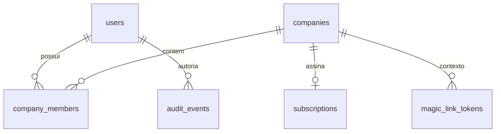

# Banco de dados

## Mecanismo de persistencia

| Motor | Versao | Biblioteca | Versao | Evidencia |
|---|---|---|---|---|
| PostgreSQL | `// CARENCIA: nao fixada no codigo` | `pg` | 8.13.1 | `server/package.json:20`; `server/package-lock.json:1120`; `docker-compose.yml:30` |

## Modelo fisico

## Inventario de entidades persistidas

| Entidade | Tabela | Chave primaria | Evidencia |
|---|---|---|---|
| Evento auditavel | `audit_events` | `id` | `server/migrations/001_init.sql:1` |
| Estado de projecao | `aggregate_projection_state` | `aggregate_key` | `server/migrations/001_init.sql:22` |
| Exportacao backup | `backup_exports` | `id` | `server/migrations/001_init.sql:41` |
| Usuario | `users` | `id` | `server/migrations/002_auth.sql:1` |
| Empresa | `companies` | `id` | `server/migrations/002_auth.sql:13` |
| Membro de empresa | `company_members` | composta/relacional | `server/migrations/002_auth.sql:24` |
| Token magic link | `magic_link_tokens` | `id` | `server/migrations/002_auth.sql:36` |
| Assinatura | `subscriptions` | `company_id` unica | `server/migrations/003_saas_base.sql:9-11` |

## Padrao de migracoes

| Item | Descricao | Evidencia |
|---|---|---|
| Ferramenta de migracao | Script Node proprio | `server/package.json:10`; `server/src/migrate.js` |
| Diretorio de migrations | `server/migrations/` | `server/migrations/001_init.sql:1`; `server/migrations/003_saas_base.sql:2` |
| Convencao de nomenclatura | Prefixo incremental `001_`, `002_`, `003_` | `server/migrations/001_init.sql`; `server/migrations/002_auth.sql`; `server/migrations/003_saas_base.sql` |
| Politica de aplicacao | Comando explicito `npm run db:migrate` | `server/package.json:10`; `server/README.md:31` |

## Politica de transacoes

`// CARENCIA: nao identificado no codigo`. Nao foi localizada politica explicita de transacoes, isolamento ou unidade de trabalho.

## Padroes de acesso a dados

O backend usa stores especializados decorados no app (`server/src/app.js:20-24`) e cliente PostgreSQL configurado por `DATABASE_URL` (`server/src/config.js:14`; `server/src/db.js:5`). O log de eventos preserva autoria por usuario autenticado (`server/src/eventStore.js:153`).

## Otimizacoes

| Tipo | Tabela ou view | Motivo aparente | Evidencia |
|---|---|---|---|
| Indice | `audit_events` por agregado/tempo | Consulta de eventos por agregado/ordem | `server/migrations/001_init.sql:16` |
| Indice | `audit_events` por sincronizacao | Pull/sync incremental | `server/migrations/001_init.sql:19` |
| Indice | `magic_link_tokens` por e-mail/proposito | Verificacao de token | `server/migrations/002_auth.sql:45` |
| Indice | `audit_events` por usuario/sync | Isolamento por usuario autenticado | `server/migrations/003_saas_base.sql:5` |
| Indice | `subscriptions` por plano/status | Consulta administrativa/billing | `server/migrations/003_saas_base.sql:25` |
