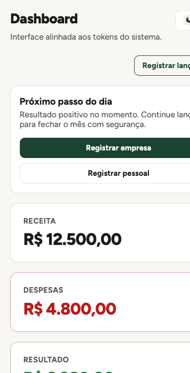
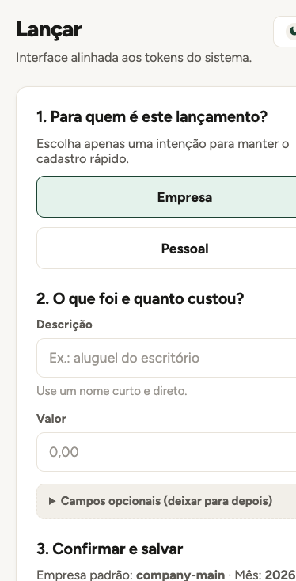
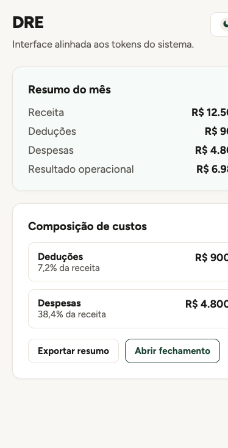
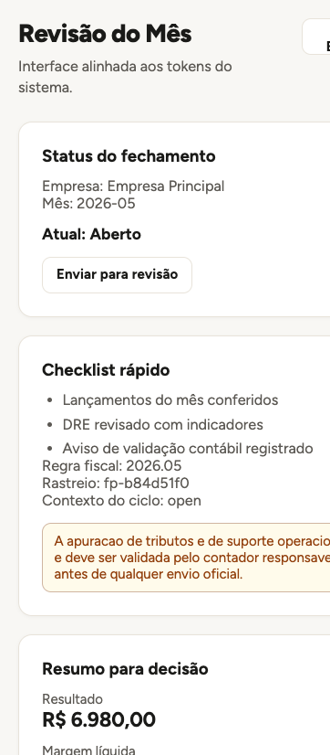

# Guia Iniciante - Como Usar o EmpresaFacil

Este guia foi feito para quem nunca usou sistema financeiro.
A ideia e simples: voce vai registrar os gastos do dia, acompanhar o resultado do mes e fechar o periodo com seguranca.

## O que voce vai fazer
1. Abrir o painel inicial (Dashboard).
2. Registrar um lancamento em 3 passos.
3. Conferir o DRE do mes.
4. Fazer a revisao e fechamento do mes.

## Tela 1 - Dashboard (visao geral)

O que olhar aqui:
1. Botao Registrar lancamento.
2. Cartao Proximo passo do dia (atalhos para comecar rapido).
3. Tres indicadores principais:
   Receita, Despesas e Resultado.

Exemplo rapido:
1. Se o Resultado estiver positivo, continue registrando os gastos normalmente.
2. Se estiver negativo, clique em Registrar lancamento e atualize os dados do dia para corrigir a visao.

## Tela 2 - Lancar (cadastro em 3 passos)

### Passo 1 - Escolher tipo
1. Empresa: gasto da empresa.
2. Pessoal: gasto pessoal (separado, para nao misturar com a empresa).

### Passo 2 - Preencher o minimo
Campos obrigatorios:
1. Descricao (exemplo: Aluguel do escritorio).
2. Valor (exemplo: 2500,00).

Campo opcional:
1. Observacao (deixe para depois se estiver com pressa).

### Passo 3 - Confirmar e salvar
1. Confirme empresa e mes.
2. Clique em Salvar lancamento.

Exemplo completo:
1. Tipo: Empresa
2. Descricao: Compra de material
3. Valor: 320,50
4. Observacao: Papelaria
5. Salvar

## Tela 3 - DRE (resultado do mes)

Aqui voce entende o resultado financeiro do mes:
1. Receita
2. Deducoes
3. Despesas
4. Resultado operacional

Tambem ha a composicao de custos (% da receita), para voce ver o peso de cada grupo.

Exemplo de leitura simples:
1. Receita: R$ 12.500,00
2. Despesas: R$ 4.800,00
3. Resultado operacional: R$ 6.980,00

Interpretacao:
1. Resultado positivo: operacao saudavel no mes.
2. Resultado negativo: revisar gastos e entradas antes de fechar o mes.

## Tela 4 - Revisao do Mes (fechamento)

Fluxo de status do mes:
1. Aberto
2. Em revisao
3. Fechado

O que fazer:
1. Verificar checklist rapido.
2. Conferir regra fiscal e rastreio.
3. Revisar resumo para decisao (resultado, margem, carga tributaria).
4. Enviar para revisao e concluir fechamento quando estiver correto.

Importante:
1. Mes fechado bloqueia alteracoes acidentais.
2. Se precisar corrigir, reabra com controle de historico.
3. O suporte de imposto e auxiliar: sempre validar com contador.

## Roteiro diario (5 minutos)
1. Abrir Dashboard.
2. Clicar em Registrar lancamento.
3. Cadastrar os gastos do dia (empresa e pessoal separados).
4. Voltar ao Dashboard e conferir Resultado.
5. No fim do mes, revisar DRE e fechar o periodo.

## Duvidas comuns (iniciante)
1. Preciso preencher tudo?
Nao. So Descricao e Valor sao obrigatorios no lancamento.

2. Posso misturar gasto pessoal com empresa?
Nao. O sistema separa os dois para nao distorcer o DRE da empresa.

3. Se eu errar um valor, perdi o fechamento?
Nao. Voce pode reabrir com controle de historico e corrigir.

4. O valor de imposto esta pronto para envio oficial?
Nao. E um apoio operacional. Sempre validar com contador.

## Dica final
Comece simples: registre tudo todos os dias. A consistencia diaria vale mais do que tentar preencher tudo de uma vez no fim do mes.
