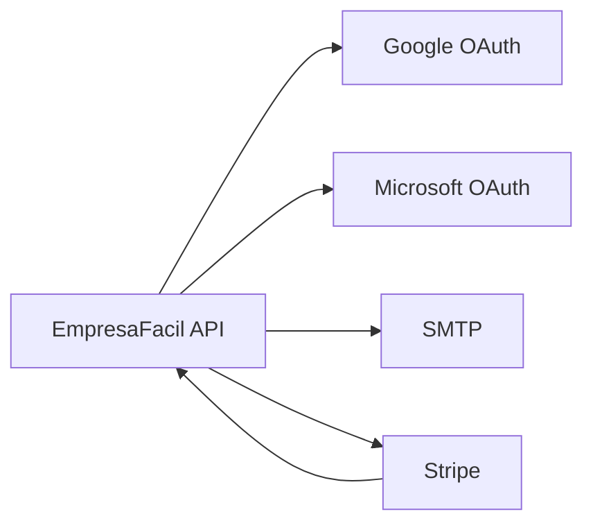

# Integracoes externas

## Catalogo de integracoes

| Integracao | Proposito | Criticidade | Ambiente | Evidencia |
|---|---|---|---|---|
| Google OAuth/userinfo | Login federado | Alta | Quando configurado | `server/src/app.js:31-40`; `server/src/routes/auth.js:12-13` |
| Microsoft OAuth/userinfo | Login federado | Alta | Quando configurado | `server/src/app.js:44-53`; `server/src/routes/auth.js:37-41` |
| SMTP | Envio de magic link e convites | Media | Quando configurado | `server/src/config.js:23-27`; `server/src/emailService.js:1-90` |
| Stripe | Checkout, portal e webhooks de assinatura | Alta | Quando configurado | `server/package.json:21`; `server/src/routes/billing.js:1-201` |

## Contratos consumidos

| Integracao | Contrato | Transporte | Formato | Autenticacao | Evidencia |
|---|---|---|---|---|---|
| Google | `/oauth2/v2/userinfo` | HTTP | JSON | Bearer access token | `server/src/routes/auth.js:12-13` |
| Microsoft | User info via OAuth2 | HTTP | JSON | Bearer access token | `server/src/routes/auth.js:39-41` |
| SMTP | Envio de mensagem | SMTP | E-mail HTML/texto | Usuario/senha SMTP | `server/src/config.js:23-27`; `server/src/emailService.js:90` |
| Stripe | Checkout/portal/webhook | HTTP SDK/webhook | JSON | Secret key/webhook secret | `server/src/config.js:28-31`; `server/src/routes/billing.js:1-201` |

## Timeout, retentativa e disjuntor

| Integracao | Timeout | Retentativa | Disjuntor | Evidencia |
|---|---|---|---|---|
| Google OAuth | `// CARENCIA` | `// CARENCIA` | `// CARENCIA` | `server/src/routes/auth.js:12-13` |
| Microsoft OAuth | `// CARENCIA` | `// CARENCIA` | `// CARENCIA` | `server/src/routes/auth.js:39-41` |
| SMTP | `// CARENCIA` | `// CARENCIA` | `// CARENCIA` | `server/src/emailService.js:1-90` |
| Stripe | `// CARENCIA` | `// CARENCIA` | `// CARENCIA` | `server/src/routes/billing.js:1-201` |

## Plano de contingencia

| Integracao | Cenario de falha | Plano | Responsavel | Evidencia |
|---|---|---|---|---|
| Billing/Stripe | Chaves ausentes | Responder `billing_unavailable` | Backend | `server/src/routes/billing.js:26`; `server/src/routes/billing.js:75` |
| OAuth | Provedor nao configurado | Rota nao registrada se client id ausente | Backend | `server/src/app.js:31-53` |
| SMTP | Falha de envio | `// CARENCIA: nao identificado no codigo` | `// CARENCIA` | `server/src/emailService.js:90` |

## Mapa visual

## Versionamento de contratos externos

`// CARENCIA: nao identificado no codigo`. Nao ha politica explicita de pinning de versao de APIs externas ou tolerancia a mudancas incompatibles alem das versoes dos SDKs no lockfile.
