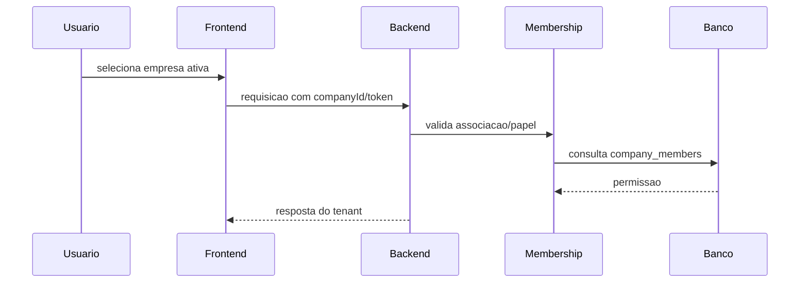

# Multi-tenancy

## Modelo de isolamento

| Camada | Modelo de isolamento | Identificador | Evidencia |
|---|---|---|---|
| Banco | Tabelas compartilhadas com discriminador por empresa/usuario conforme tabela | `company_id`, `user_id` | `server/migrations/002_auth.sql:24`; `server/migrations/003_saas_base.sql:9`; `server/migrations/003_saas_base.sql:5` |
| Frontend | Estado separado por empresa ativa | `companyId` | `src/companyStore.ts:86-498`; `src/domain.js:44-62` |
| Cache | `// CARENCIA` | `// CARENCIA` | `// CARENCIA: nao identificado no codigo` |
| Filas | `// CARENCIA` | `// CARENCIA` | `// CARENCIA: nao identificado no codigo` |
| Armazenamento de arquivos | LocalStorage/cliente para anexos; segregacao server-side nao identificada | `// CARENCIA` | `src/attachmentStore.ts:16-26` |

## Resolucao do tenant na entrada

| Tipo de entrada | Fonte do identificador | Resolvedor | Evidencia |
|---|---|---|---|
| Rotas de membros | Segmento `:companyId` | Handler da rota | `server/src/routes/members.js:10-127` |
| Rotas admin empresa | Segmento `:companyId` | Handler admin | `server/src/routes/admin.js:101-144` |
| Sync/eventos | JWT fornece `userId`; eventos carregam contexto | Event store | `server/src/eventStore.js:153`; `server/migrations/003_saas_base.sql:5` |
| Frontend | Empresa ativa no `localStorage` | Company store | `src/companyStore.ts:86-498` |

## Roteamento de dados por tenant

| Operacao | Mecanismo | Risco se mal aplicado | Evidencia |
|---|---|---|---|
| Lancamentos frontend | `companyId` obrigatorio | Mistura entre empresas | `src/domain.js:44-62` |
| Empresas/membros backend | `companyId` no path e tabela relacional | Acesso cruzado entre empresas | `server/src/routes/members.js:10-127`; `server/migrations/002_auth.sql:24` |
| Assinaturas | `company_id` unico | Plano aplicado a empresa errada | `server/migrations/003_saas_base.sql:9-11` |
| Eventos sincronizados | `userId` do JWT | Cliente forjar autoria | `server/src/eventStore.js:153` |

## Segregacao de recursos compartilhados

| Recurso | Estrategia | Padrao | Evidencia |
|---|---|---|---|
| Banco | Discriminadores em tabelas | `company_id`, `user_id` | `server/migrations/002_auth.sql:24`; `server/migrations/003_saas_base.sql:5` |
| Estado local | Chaves e empresa ativa | `ACTIVE_COMPANY_STORAGE_KEY` | `src/companyStore.ts:86-498` |
| Cache | `// CARENCIA` | `// CARENCIA` | `// CARENCIA: nao identificado no codigo` |
| Filas | `// CARENCIA` | `// CARENCIA` | `// CARENCIA: nao identificado no codigo` |

## Ciclo de vida de tenants

| Etapa | Operacao | Componente | Evidencia |
|---|---|---|---|
| Criacao/reivindicacao | Claim de empresa | Onboarding | `server/src/routes/onboarding.js:13` |
| Ativacao | `// CARENCIA` | `// CARENCIA` | `// CARENCIA: nao identificado no codigo` |
| Suspensao | Estado/plano de assinatura | Subscription | `server/migrations/003_saas_base.sql:9-25` |
| Remocao | `// CARENCIA` | `// CARENCIA` | `// CARENCIA: nao identificado no codigo` |

## Garantias de nao vazamento

Ha testes de isolamento de contexto de empresa no frontend (`package.json:10`, item `tests/company-context-isolation.test.js`) e migracao legada por empresa (`package.json:10`, item `tests/company-legacy-migration.test.js`). Testes de isolamento backend por tenant nao foram identificados: `// CARENCIA: nao identificado no codigo`.
