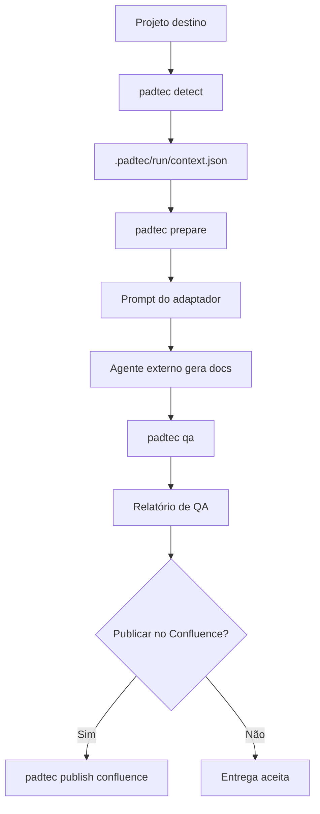

# Proposta técnica - automação do guia humano por CLI

## Objetivo

Esta proposta descreve uma evolução do PADTec para automatizar o máximo possível do fluxo descrito em `guia-humano.md`, sem eleger um executor padrão de agente.

O objetivo é transformar o guia humano em um fluxo assistido por linha de comando, mantendo o PADTec independente de ambiente e compatível com execução por diferentes agentes, como VS Code com Copilot Chat, Codex Desktop e Claude Desktop.

O PADTec não deve tentar controlar a interface gráfica desses ambientes. A automação proposta prepara o contexto, gera instruções específicas por adaptador e valida a documentação produzida após a execução do agente.

## Princípios

1. **Núcleo independente de executor.** O PADTec detecta, prepara e valida; o agente externo executa a geração documental.
2. **Adaptadores explícitos.** Cada ambiente recebe instruções no formato mais adequado para seu modo de uso.
3. **Contexto canônico.** A detecção do projeto gera um arquivo estruturado reutilizável por todos os adaptadores.
4. **Humano mantém decisões de escopo.** A escolha final do nível documental e a aceitação da entrega continuam sob responsabilidade humana.
5. **Sem automação frágil de interface.** A CLI não deve automatizar cliques, campos de chat ou janelas de aplicativo.
6. **Portabilidade por cópia.** A solução preserva o modelo atual: o pacote `padtec/` é copiado para dentro do projeto destino.

## Fluxo proposto



## Comandos do MVP

### `padtec detect`

Analisa o projeto destino e produz o contexto canônico da execução.

Responsabilidades:

- identificar a pasta de saída documental (`docs/`, `documentation/`, `documentacao/` ou criar proposta para `docs/`);
- detectar variante provável (`full-stack-web`, `backend-api`, `frontend-site`, `automacao-script`, `iac`);
- detectar capacidades ativas;
- detectar monorepo;
- listar seções previstas para o nível informado, quando houver nível;
- registrar evidências de detecção para auditoria.

Exemplo:

```bash
padtec detect
```

Saída principal:

```text
.padtec/run/context.json
.padtec/run/detection-report.md
```

### `padtec prepare`

Gera um pacote de execução para o agente escolhido.

Exemplos:

```bash
padtec prepare --level L2 --target vscode
padtec prepare --level L2 --target codex
padtec prepare --level L2 --target claude
```

Responsabilidades:

- validar se `context.json` existe ou executar detecção antes de preparar;
- aplicar o nível documental escolhido;
- montar plano de execução;
- gerar prompt específico para o adaptador;
- informar ao usuário qual arquivo abrir ou enviar no ambiente de agente.

Saídas:

```text
.padtec/run/execution-plan.md
.padtec/run/prompt-vscode.md
.padtec/run/prompt-codex.md
.padtec/run/prompt-claude.md
```

### `padtec qa`

Executa validações objetivas sobre a documentação gerada.

Exemplo:

```bash
padtec qa --level L2
```

Responsabilidades:

- validar presença dos arquivos esperados por nível;
- validar existência de arquivos condicionais para capacidades ativas;
- contar termos mínimos do glossário;
- verificar presença de diagramas Mermaid obrigatórios;
- procurar termos proibidos relacionados a estimativa, cronograma, custo e esforço;
- verificar ocorrência de `// CARÊNCIA: não identificado no código`;
- amostrar padrões de citação rastreável;
- gerar relatório de aprovação, reprovação e correções necessárias.

Saída:

```text
.padtec/run/qa-report.md
```

### `padtec publish confluence`

Encapsula o ferramental existente em `confluence-mermaid-package/`.

Exemplo:

```bash
padtec publish confluence --dry-run
```

Responsabilidades:

- validar configuração de publicação;
- converter Markdown para ADF;
- executar pré-visualização ou dry-run;
- publicar em lote quando explicitamente autorizado.

Este comando é opcional e não faz parte do fluxo mínimo de geração documental.

## Contrato do contexto canônico

Arquivo sugerido: `.padtec/run/context.json`.

Exemplo:

```json
{
  "padtecVersion": "v1.0.1",
  "schemaVersion": "1.0",
  "projectRoot": ".",
  "outputDir": "docs",
  "level": "L2",
  "variant": "backend-api",
  "capabilities": [
    "banco-de-dados",
    "auth",
    "integracoes-externas"
  ],
  "monorepo": {
    "active": false,
    "workspaces": []
  },
  "sections": [
    "01-visao-geral",
    "02-arquitetura",
    "03-stack-e-dependencias",
    "04-estrutura-do-projeto",
    "05-modelo-de-dominio",
    "06-fluxos-de-negocio",
    "07-interface-externa",
    "08-frontend",
    "09-backend",
    "10-configuracao-e-ambientes",
    "11-infraestrutura-e-deployment"
  ],
  "conditionalSections": [
    "condicional-banco-de-dados",
    "condicional-autenticacao-e-autorizacao",
    "condicional-integracoes-externas"
  ],
  "evidence": {
    "variant": [
      "package.json"
    ],
    "capabilities": {
      "banco-de-dados": [
        "package.json",
        "src/"
      ],
      "auth": [
        "package.json",
        "src/"
      ],
      "integracoes-externas": [
        "src/"
      ]
    }
  }
}
```

Campos obrigatórios:

| Campo | Descrição |
|---|---|
| `padtecVersion` | Versão do pacote PADTec instalado no projeto destino. |
| `schemaVersion` | Versão do contrato de `context.json`. |
| `projectRoot` | Raiz relativa do projeto destino. |
| `outputDir` | Pasta de documentação resolvida. |
| `level` | Nível documental escolhido ou sugerido. |
| `variant` | Variante detectada. |
| `capabilities` | Lista de capacidades ativas. |
| `monorepo` | Estado de monorepo e workspaces detectados. |
| `sections` | Seções do núcleo previstas para o nível. |
| `conditionalSections` | Seções condicionais previstas. |
| `evidence` | Evidências usadas para justificar detecção. |

## Adaptadores

### Adaptador `vscode`

Destino: VS Code com Copilot Chat.

Saída principal: `.padtec/run/prompt-vscode.md`.

Características:

- prompt único para o usuário enviar no Copilot Chat;
- instruções explícitas para ler `padtec/prompts/00-mestre.md`;
- referência ao `context.json`;
- proibição de pedir ao usuário para colar código;
- orientação para gerar documentação na pasta definida em `outputDir`;
- indicação para executar ou solicitar `padtec qa` ao final.

Limite conhecido:

- a CLI não deve tentar automatizar a interface do VS Code.

### Adaptador `codex`

Destino: Codex Desktop.

Saída principal: `.padtec/run/prompt-codex.md`.

Características:

- prompt otimizado para agente com acesso direto ao workspace;
- instruções de execução mais operacionais;
- indicação de arquivos que devem ser lidos primeiro;
- comandos de validação sugeridos;
- orientação para preservar mudanças existentes no projeto destino.

Limite conhecido:

- a CLI prepara a execução, mas não assume que o Codex Desktop está aberto, focado ou conectado ao workspace correto.

### Adaptador `claude`

Destino: Claude Desktop.

Saída principal: `.padtec/run/prompt-claude.md`.

Características:

- instruções explícitas sobre dependência de acesso real ao filesystem por conector ou MCP;
- bloqueio conceitual quando o ambiente não tiver acesso aos arquivos;
- sequência de leitura inicial do pacote e do `context.json`;
- orientação para não solicitar colagem manual de código quando o conector de arquivos estiver disponível.

Limite conhecido:

- quando Claude Desktop não tiver acesso nativo ao projeto, este adaptador deve orientar o usuário a configurar acesso antes da execução. O PADTec não deve degradar para fluxo de colagem manual de arquivos.

## Estrutura de arquivos proposta

```text
padtec/
+-- cli/
|   +-- padtec.js
|   +-- commands/
|   |   +-- detect.js
|   |   +-- prepare.js
|   |   +-- qa.js
|   |   +-- publish-confluence.js
|   +-- adapters/
|   |   +-- vscode.js
|   |   +-- codex.js
|   |   +-- claude.js
|   +-- lib/
|       +-- project-detection.js
|       +-- context-schema.js
|       +-- section-resolution.js
|       +-- markdown-qa.js
+-- docs/
    +-- proposta-automacao-cli.md
```

## Escopo do MVP

O MVP deve entregar apenas automações que reduzam trabalho manual sem depender de controle de interface gráfica.

Incluído:

- `padtec detect`;
- `padtec prepare --level <L1|L2|L3> --target <vscode|codex|claude>`;
- `padtec qa --level <L1|L2|L3>`;
- geração de `.padtec/run/context.json`;
- geração dos prompts de adaptador;
- relatório de QA em Markdown.

Fora do MVP:

- execução automática do agente;
- integração nativa com APIs proprietárias de agentes;
- publicação Confluence automática sem dry-run;
- atualização automática do pacote PADTec instalado em projetos destino;
- UI gráfica.

## Relação com o guia humano

| Passo do guia humano | Automação proposta | Mantém decisão humana? |
|---|---|---|
| Copiar `padtec/` | `padtec init` ou distribuição manual assistida | Parcial |
| Escolher nível | `padtec prepare --level` com sugestão opcional | Sim |
| Invocar prompt mestre | prompt de adaptador gerado automaticamente | Sim |
| Aguardar geração | execução pelo agente externo | Sim |
| Validar saída | `padtec qa` | Parcial |
| Publicar no Confluence | `padtec publish confluence` | Sim |

## Riscos

1. **Detecção excessivamente confiante.** A CLI pode classificar variante ou capacidade de forma incorreta quando o projeto tem estrutura incomum.
2. **Divergência entre adaptadores.** Prompts para ambientes diferentes podem produzir comportamentos distintos se não forem gerados a partir do mesmo `context.json`.
3. **QA superficial.** Validações automáticas conseguem verificar estrutura e padrões, mas não substituem revisão técnica integral.
4. **Ambiente sem acesso real a arquivos.** Adaptadores perdem valor se o agente não conseguir ler o projeto diretamente.
5. **Acúmulo de estado em `.padtec/run/`.** Execuções sucessivas precisam sobrescrever ou versionar artefatos de forma previsível.

## Decisões pendentes

1. Definir se a CLI será implementada em Node.js puro, para manter proximidade com o ferramental Confluence existente.
2. Definir se `padtec init` pertence ao pacote instalado ou a uma ferramenta externa usada para copiar o pacote.
3. Definir se o nível padrão sugerido será sempre `L2` ou se haverá heurística de recomendação.
4. Definir política de sobrescrita para `.padtec/run/`.
5. Definir se o `qa-report.md` deve ser apenas diagnóstico ou também gerar prompts corretivos para o agente.

## Recomendação

Implementar primeiro `detect`, `prepare` e `qa`.

Essa sequência automatiza a maior parte operacional do `guia-humano.md`, preserva compatibilidade com múltiplos agentes e evita dependência de interfaces instáveis. O comando de publicação Confluence deve ser tratado como segunda etapa, porque já existe ferramental consolidado e porque envolve credenciais, páginas remotas e risco operacional maior.
